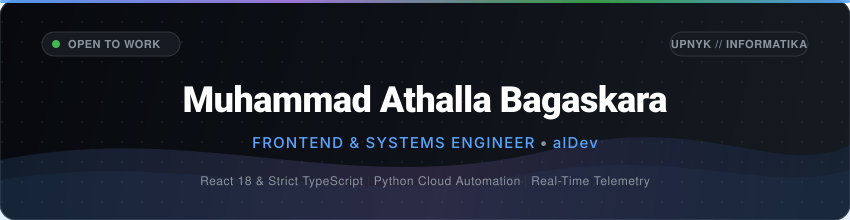

<div align="center">

  <!-- Header Banner -->
  

  <br/><br/>

  <!-- Animated Typing Tagline -->
  <a href="https://muhmdathalla.github.io/dev/">
    
  </a>

  <br/><br/>

  <!-- Profile Badges & Highlights -->
  <p align="center">
    <a href="https://muhmdathalla.github.io/dev/">
      
    </a>
    <a href="mailto:iamathaalla@gmail.com">
      
    </a>
    <a href="https://x.com/muhmdathalla">
      
    </a>
    <a href="https://github.com/muhmdathalla">
      
    </a>
  </p>

  <!-- Visitor Counter -->
  <p align="center">
    
  </p>

</div>

---

### 👨‍💻 About Me

```yaml
name: Muhammad Athalla Bagaskara
alias: alDev / Athalla
role: Frontend & Systems Engineer
education: Computer Science Undergrad @ UPN "Veteran" Yogyakarta
current_focus:
  - Enterprise React 18 & Strict TypeScript Architecture
  - Real-time Market & Weather Telemetry Engines
  - Low-latency Cross-device Bridge Systems & Playwright Automation
design_philosophy: "Minimalist, High-Contrast Editorial Aesthetics & Zero Layout Shift"
location: Yogyakarta, Indonesia 🇮🇩
```

---

### 🛠️ Tech Stack & Weapons of Choice

<div align="center">

| Domain | Technologies & Frameworks |
| :--- | :--- |
| **Frontend & Core Web** |        |
| **Backend & Systems** |      |
| **Automation, Cloud & Tools**|      |

</div>

---

### 🚀 Featured Engineering Projects

<table>
  <tr>
    <td width="50%" valign="top">
      <h3 align="left">
        <a href="https://github.com/muhmdathalla/dev">⚡ dev // Engineering Portfolio</a>
      </h3>
      <p>Personal portfolio & engineering platform with zero layout shift, real-time USD/IDR & IDX market telemetry, Open-Meteo weather art engine, and strict monochrome glassmorphic UI.</p>
      <p>
        
        
        
      </p>
      <p>
        🔗 <a href="https://muhmdathalla.github.io/dev/">Live Production Demo</a>
      </p>
    </td>
    <td width="50%" valign="top">
      <h3 align="left">
        <a href="https://github.com/muhmdathalla/nativecopy">📱 NativeCopy // Real-Time VS Code Bridge</a>
      </h3>
      <p>Cross-device clipboard sync & live remote code injection system. Type or upload code from your mobile device directly into your laptop's active VS Code workspace in real time.</p>
      <p>
        
        
        
      </p>
      <p>
        🔗 <a href="https://github.com/muhmdathalla/nativecopy">Source Code & Documentation</a>
      </p>
    </td>
  </tr>
  <tr>
    <td width="50%" valign="top">
      <h3 align="left">
        <a href="https://github.com/muhmdathalla/educrypto">🛡️ EduCrypto Studio</a>
      </h3>
      <p>Professional cryptographic workbench featuring pure editorial monochrome aesthetic, Swiss grid architecture, live status telemetry, and floating liquid glass dock.</p>
      <p>
        
        
        
      </p>
      <p>
        🔗 <a href="https://github.com/muhmdathalla/educrypto">View Workbench</a>
      </p>
    </td>
    <td width="50%" valign="top">
      <h3 align="left">
        <a href="https://github.com/muhmdathalla/spada-presence">🤖 SPADA UPNYK Auto-Presence</a>
      </h3>
      <p>Cloud-scheduled automated academic attendance pipeline for SPADA UPNYK portal with Playwright headless browser, Telegram verification bot, and 24/7 GitHub Actions execution.</p>
      <p>
        
        
        
      </p>
      <p>
        🔗 <a href="https://github.com/muhmdathalla/spada-presence">View Automation Pipeline</a>
      </p>
    </td>
  </tr>
</table>

---

### 📊 GitHub Activity & Metrics

<div align="center">
  <table border="0">
    <tr>
      <td align="center" width="50%">
        
      </td>
      <td align="center" width="50%">
        
      </td>
    </tr>
    <tr>
      <td colspan="2" align="center">
        
      </td>
    </tr>
  </table>
</div>

---

### 🌐 Connect & Network

<div align="center">

  <a href="https://muhmdathalla.github.io/dev/">
    
  </a>
  &nbsp;
  <a href="mailto:iamathaalla@gmail.com">
    
  </a>
  &nbsp;
  <a href="https://x.com/muhmdathalla">
    
  </a>
  &nbsp;
  <a href="https://github.com/muhmdathalla">
    
  </a>

</div>

<br/>

<div align="center">
  <sub>Designed with precision & engineered with passion by <b>Muhammad Athalla Bagaskara</b> • Built for modern engineering standards</sub>
</div>
